<!-- HEADER BANNER -->

<!-- BADGES & SOCIALS -->

  
  
  
  

Sou William Gabriel da Silva, tenho 17 anos e sou estudante de Desenvolvimento de Sistemas no SESI. Tenho grande interesse pela área de tecnologia, especialmente pelo desenvolvimento de software e pelo universo Full Stack. Atualmente, estou desenvolvendo minhas habilidades em programação, buscando aprimorar minha lógica, criatividade e capacidade de resolver problemas. Tenho interesse em tecnologias como Java, HTML, CSS, Python e C, além de estar sempre disposto a aprender novas linguagens e ferramentas. Meu objetivo é transformar conhecimentos em projetos práticos, adquirir experiência e evoluir constantemente como desenvolvedor.

---

### My Stack

 

  
  
  
  
  
  
  
  
  
  
  
  

---

### GitHub Stats

  
  

---

### Contribution Snake

<picture>
  <source media="(prefers-color-scheme: dark)" srcset="https://raw.githubusercontent.com/Will27042009/Will27042009/output/github-contribution-grid-snake-dark.svg">
  <source media="(prefers-color-scheme: light)" srcset="https://raw.githubusercontent.com/Will27042009/Will27042009/output/github-contribution-grid-snake.svg">
  
</picture>

 

<i>"Não desista. Deus está preparando algo maior do que você imagina. (Jeremias 29:11)"</i>

